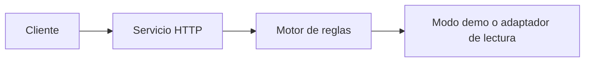

# Despliegue y operación

## Lo documentado

La conversación anterior identificó Python, FastAPI, RapidFuzz y Docker como tecnologías de la v0.4.0 y mostró comandos de `docker compose` para reconstruir el servicio. Esos elementos se documentan como contexto reportado, no como una verificación del árbol fuente presente en este espacio.

## Topología mínima

## Operación segura

1. Construir la imagen desde el proyecto versionado.
2. Ejecutar pruebas de contrato y regresión.
3. Confirmar que el catálogo no contiene escrituras ejecutables.
4. Iniciar el servicio con configuración explícita.
5. Validar una consulta simple y una compuesta.
6. Revisar que un caso mixto sea bloqueado.

## No afirmado

No se afirma una topología Kubernetes/K3s, alta disponibilidad, ingress, observabilidad externa, autenticación o persistencia de sesión porque no se entregaron archivos que lo demuestren.

