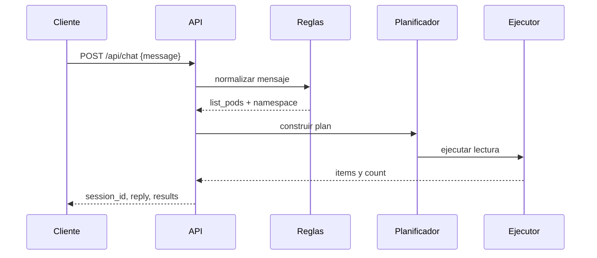
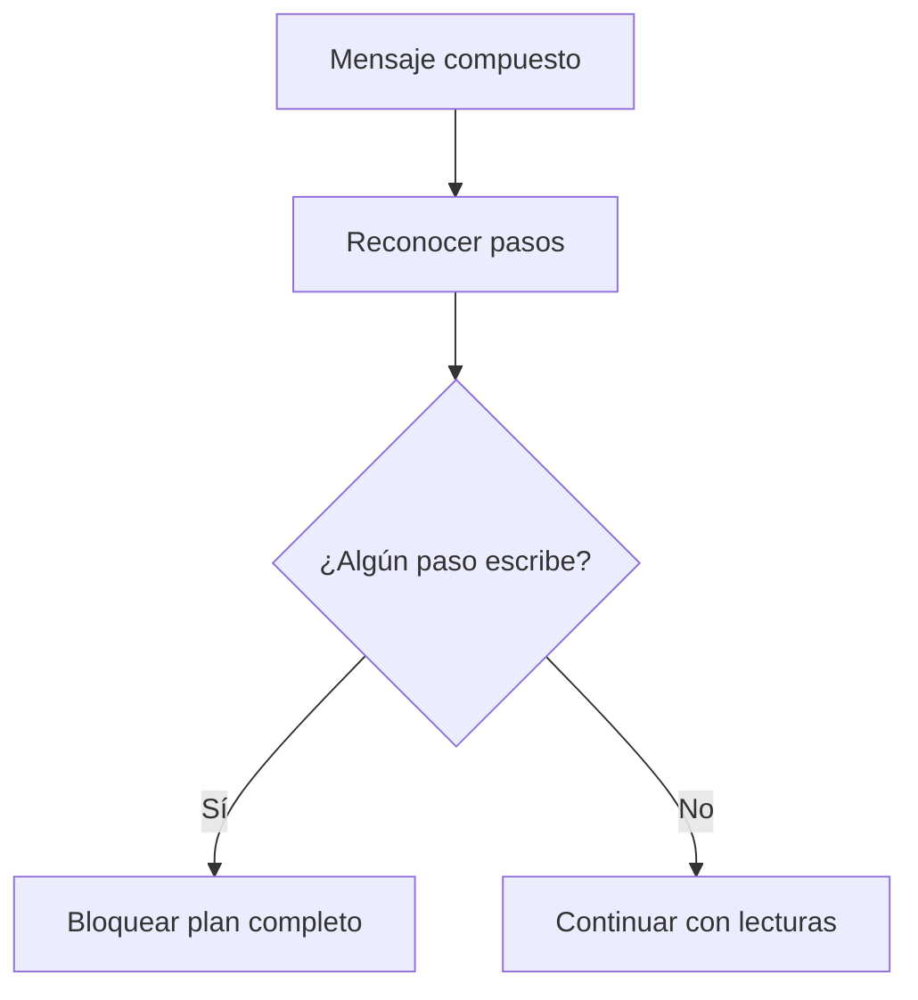

# Flujos principales

## Consulta simple

## Solicitud compuesta en v0.4.0

La evidencia muestra un mensaje de pods y eventos que produce dos operaciones. El namespace del primer paso fue `demo`; la salida observada del segundo paso mostró `namespace: null`, aunque el evento pertenecía a `demo`. Esa diferencia es un defecto de trazabilidad y no debe ocultarse.

## Solicitud con escritura

## Flujo propuesto de contexto v0.5.0

1. Extraer entidades explícitas.
2. Guardar solo entidades válidas y acotadas.
3. Completar parámetros faltantes en pasos compatibles.
4. Resolver referencias solo cuando exista un candidato claro.
5. Pedir aclaración si la referencia es ambigua.
6. Reaplicar la política de solo lectura.
7. Ejecutar y actualizar el contexto con resultados sanitizados.

