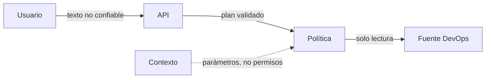

# Seguridad y controles

## Activos

- Disponibilidad e integridad de la fuente DevOps.
- Información de pods, eventos, namespaces y mensajes de error.
- Estado de sesión y referencias de recursos.
- Capacidad de ejecutar operaciones en el entorno.

## Límites de confianza

## Amenazas y mitigaciones

| Amenaza | Mitigación requerida |
|---|---|
| Inyección de una operación de escritura en un mensaje compuesto | Denegar el plan completo antes de ejecutar |
| Contexto usado como autorización | Mantener permisos fuera del contexto y reaplicar política |
| Referencia ambigua a un recurso | Pedir aclaración; no escoger arbitrariamente |
| Fuga de datos entre sesiones | Asociar contexto a `session_id` y aplicar expiración |
| Resultados no trazables | Etiquetar cada paso con intención, parámetros y estado |
| Fuente real no disponible | Declarar modo demo o error de fuente, nunca simular éxito silenciosamente |

## Reglas de seguridad

- Solo ejecutar intenciones incluidas en el catálogo permitido.
- No interpretar palabras de contexto como comandos privilegiados.
- No almacenar secretos en `reply`, resultados o contexto.
- Registrar eventos de bloqueo y ambigüedad sin incluir datos sensibles innecesarios.
- Añadir pruebas de regresión para cada operación de escritura detectada.

## Estado

La barrera de solo lectura y el bloqueo de solicitudes mixtas forman parte de la línea base descrita. Autenticación, autorización de usuarios, TLS, gestión de secretos y auditoría persistente no se consideran implementados sin evidencia adicional.

