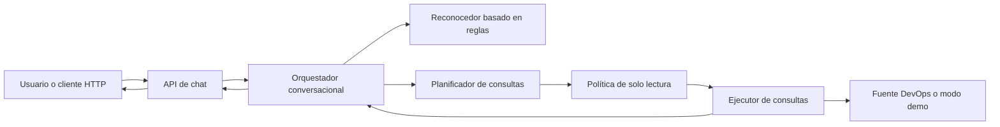
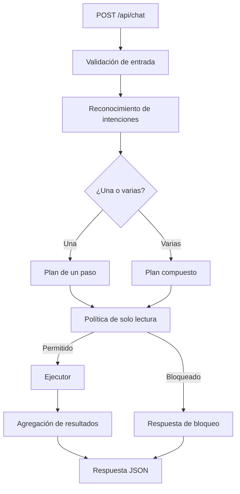
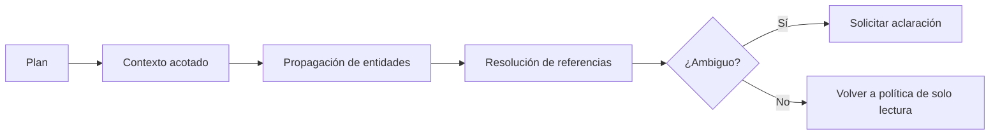

# Diseño del sistema

## 1. Resumen

El sistema recibe un mensaje, identifica una o más intenciones mediante reglas, construye un plan y ejecuta solo consultas permitidas. La respuesta combina un resumen legible con resultados estructurados. En v0.4.0 el contexto entre pasos no está garantizado; v0.5.0 propone una capa explícita de contexto.

## 2. Vista de contexto

La fuente exacta de datos y el adaptador de clúster no están documentados en la evidencia disponible; por eso el diagrama los trata como una dependencia abstracta con modo demo observado.

## 3. Vista de contenedores lógicos

## 4. Evolución propuesta

El contexto nunca debe saltarse la política de seguridad.

